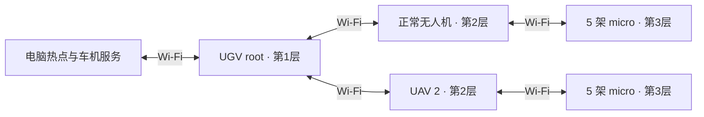
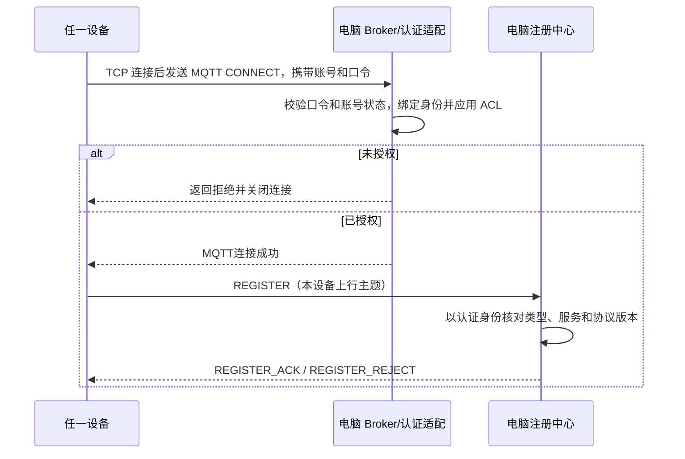

# 车机终端与机群通信设计

电脑开 2.4 GHz Wi-Fi 热点，UGV 的 STA 接入电脑，两架 UAV 各带 5 架 micro 作为初始规划。
现有三块 C6 用于复现一条链路，验证协议与恢复行为。

## 1. 整体流程

Mesh-Lite 承载 IP 网络。首阶段使用 **MQTT 5.0 over TCP（明文）**。
节点各自主动连接电脑上的 Broker，电脑维护设备授权、服务目录及任务记录。视频走独立的媒体会话。固件复用 ESP-IDF 5.5.5 自带的 `mqtt` 组件。

业务 JSON 放在 MQTT `PUBLISH` 的负载中。ESP-MQTT 负责在 TCP 字节流上组装和解析 MQTT 报文。

### 1.1 从上电到业务运行

1. **启动与组网。**电脑启动热点、Broker 和注册中心。UGV 接入电脑热点，两架 UAV 接入 UGV，micro 接入各自的 UAV。节点取得 IP 后主动连接电脑的 TCP 1883 端口。
2. **鉴权与拒接。**节点发送 MQTT 5.0 `CONNECT`。Broker 校验账号、口令和启用状态，绑定节点身份及主题权限。`CONNACK` 原因码表示连接结果，授权失败时 Broker 关闭连接。
3. **注册与公告。**节点订阅自己的注册回执及命令主题，收到 `SUBACK` 后提交 `REGISTER`。电脑核对身份、类型、基础能力和服务清单，分配 `session_id`，回送 `REGISTER_ACK`，并向授权订阅端发布目录。
4. **接收、更新与任务。**订阅端应用最新目录版本。设备类型与能力随注册或审核后的清单更新发布，任务状态在接受、开始或结束等节点上报。电脑沿已建立的连接下发任务和视频控制命令，视频经独立媒体会话回传。
5. **离线与恢复。**Broker 断连事件或与当前连接匹配的遗嘱触发目录状态更新。设备恢复后重新鉴权、订阅和注册，任务管理按任务 ID 核对未决结果。

### 1.2 连接、拓扑与协议配置

ESP-IDF 5.5.5 中启用 `CONFIG_MQTT_PROTOCOL_5=y`，客户端选择 `.session.protocol_ver = MQTT_PROTOCOL_V_5`。Broker 和车机订阅客户端也配置为支持 MQTT 5.0。`mqtt://` URI 表示 TCP 传输，MQTT 版本由客户端协议配置指定。业务 JSON 的 `schema_version` 独立于 MQTT 协议版本。[ESP-MQTT 5.0 接口](https://docs.espressif.com/projects/esp-idf/zh_CN/v5.5.5/esp32c6/api-reference/protocols/mqtt.html)



| 位置 | 网络职责 | 业务职责 |
| --- | --- | --- |
| 电脑 | 提供热点，供 UGV STA 接入 | MQTT Broker、设备授权管理、服务注册中心、任务管理 |
| UGV | STA 接电脑，SoftAP 带 UAV，IP 转发/NAPT | 上报自身身份、服务、状态；执行面向自身的任务 |
| UAV | STA 接 UGV，SoftAP 带 micro，IP 转发/NAPT | 上报自身身份、服务、状态；执行面向自身的任务 |
| micro UAV | STA 接 UAV，保持叶子节点 | 上报自身身份、服务、状态；执行面向自身的任务 |

每个节点的 MQTT/TCP 会话都终止于电脑。micro 到电脑的流量经 UAV 和 UGV 转发，在当前热点设计下共占用三段无线链路。中继通过各自的 MQTT 会话上报自身状态。

`chain` 的层级限制只确定第 3 层设备的父节点在第 2 层。5+5 需要在接入规划中配置并用每台 micro 的父 BSSID 核验。现有样例配置中每个 SoftAP 允许 6 个客户端，DHCP 站点上限为 8。两架 UAV 各接 5 台可以作为接入验证起点。单 UAV 失效后，另一架按当前配置最多再接 1 台，接入和视频带宽要分别做故障验收。

下面地址仅为示意，部署时以实际热点及 Mesh-Lite 分配结果为准：

```text
电脑热点：192.168.137.1，Broker TCP 端口：1883
MQTT URI：mqtt://192.168.137.1:1883
UGV：STA 192.168.137.2；AP 192.168.5.1
UAV：STA 192.168.5.2；AP 192.168.4.1
micro：STA 192.168.4.2

micro 主动连接电脑：
192.168.4.2:源端口
  → UAV 的 NAPT
192.168.5.2:转换后端口
  → UGV 的 NAPT
192.168.137.2:转换后端口
  → 电脑 192.168.137.1:1883
```

电脑下发命令时，由 Broker 向目标客户端已经建立的连接发送 MQTT 消息，经现有 NAPT 会话返回下游。由于 NAPT，电脑可能看到多个节点使用相同源 IP，设备身份由认证凭据确定。

实际接入时需完成：

- 电脑热点使用 C6 可接入的 2.4 GHz 网络。Broker 的 TCP 1883 监听热点接口，并通过防火墙限制接入范围。
- 给 UGV 配置电脑热点 SSID/密码，保持固定第1层；UAV 和 micro 保持禁止成为 root，分别固定第2、3层。
- 复用 Mesh-Lite/IoT-Bridge 的配置与连接流程，不另起一套 `esp_wifi_connect()` 重连逻辑与组网核心竞争。
- 同一个 C6 的 STA/SoftAP 共用射频，实际 Mesh 信道应跟随电脑热点；不能在热点使用其他信道时仍要求下游独立固定在6信道。
- 各节点配置同一个 `BROKER_HOST`，取电脑热点侧地址。子节点的默认网关仍由各自父节点提供。
- 本地热点无互联网时也应能访问电脑服务；互联网连通不作为注册成功条件。电脑服务不可达时，设备保持本地网络状态并进入控制服务离线状态。


## 2. 各项要求的实现

### 2.1 身份鉴权

为每个节点预置唯一 `node_id`、MQTT 用户名和独立实验口令。首阶段令设备用户名等于 `node_id`。Broker 将通过验证的用户名绑定到连接身份，注册中心再按授权表检查设备类型和服务范围。车机内部服务使用独立账号和主题权限。

| 授权表字段 | 示例/作用 |
| --- | --- |
| node_id | `micro-001` |
| credential_id | 账号凭据版本或编号，用于审计和轮换 |
| enabled | 是否允许接入 |
| device_type | `ugv`、`uav`、`micro_uav` 中的授权类型 |
| allowed_services | 允许注册的服务类型集合 |
| publish_permissions | 允许写入的本设备上行主题 |
| command_permissions | 允许接收的命令类型 |

连接校验流程：



Broker 配置 `allow_anonymous false`。首轮可用 Mosquitto 口令文件、主题 ACL 和预置授权表，统一管理账号启用和口令轮换。若要在运行时通过管理接口启停设备，Broker 认证模块需读取同一份授权状态，并提供断开活动会话的执行路径。

MQTT Client ID 绑定已认证的用户名，防止设备通过冒用其他 Client ID 挤掉合法连接。采用 Mosquitto 时可使用 `use_username_as_clientid`。Broker 强制执行主题权限，注册中心以该主题路径的 `node_id` 确定身份，并核对消息里的 `node_id`。

停用设备时先禁止新连接，再撤销现有业务权限、断开活动会话并下架其服务与媒体授权。实验口令通过可信工位注入，在 Broker 侧以口令散列保存。固件源码、构建参数和日志只记录账号和凭据编号。后续如需正式安全验收，再选定满足目标的车机身份校验和传输保护方案。

### 2.2 未授权节点拒接

无线网络准入和业务准入分别设置和验收。

Broker 在 `CONNECT` 阶段拒绝无效凭据或停用账号，记录 `CONNACK` 原因码，例如 `0x86`（用户名或密码错误）、`0x87`（未授权），并以实际 Broker 响应为准。已登录账号的越权发布或订阅由主题 ACL 拒绝。注册中心对身份不一致、未经批准的能力或服务返回 `REGISTER_REJECT`，拒绝的描述不会进入目录。

| 层次 | 机制 | 能保证的范围 |
| --- | --- | --- |
| Wi-Fi 接入 | 为热点及各级 Mesh SoftAP 设置密码；按 Mesh 参数组网 | 不持有对应网络凭据的设备无法按正常认证流程入网；Mesh ID、MAC 不是密码学设备身份 |
| 业务连接 | 独立设备账号和口令，Broker 禁止匿名并校验账号授权状态 | 缺少有效凭据或账号停用时拒绝业务连接 |
| 消息操作 | MQTT Topic ACL，加注册中心的字段与权限校验 | 已登录的设备不能冒充其他设备、发布权威目录或下发任务 |

首阶段在受控实验网络验证账号拒接和业务权限。MQTT 口令和消息在 TCP 中以明文传输。持有泄露口令的一方可以冒用对应账号，设备通过配置的地址找到车机，但无法验证对端的密码学身份。消息保密、防篡改、抗凭据重放和车机身份验证属于后续安全验收范围。

若验收要求持有共享 Wi-Fi 密码的未知设备也无法关联或获得 IP，需在各级 SoftAP 单独设计并验证逐设备准入。

### 2.3 服务注册、公告、接收与更新

设备向电脑提交“候选描述”，电脑审核后发布“权威目录”。公告是 MQTT 的应用级发布/订阅，不是让 UDP 广播穿过所有父子子网。

| 消息/动作 | 发送方 → 接收方 | 作用 |
| --- | --- | --- |
| REGISTER | 设备 → 注册中心 | 提交本次启动的类型、基础能力、服务完整清单 |
| REGISTER_ACK/REJECT | 注册中心 → 设备 | 明确登记是否完成，返回会话标识及租约 |
| CATALOG_UPSERT | 注册中心 → 订阅者 | 公告已审核的设备/服务及目录版本 |
| DESCRIPTOR_UPDATE | 设备 → 注册中心 | 以新 descriptor_rev 提交新的完整清单 |
| HEARTBEAT（可选） | 设备 → 注册中心 | 需要验证应用进程活性时，低频刷新租约 |
| STATE_REPORT | 设备 → 注册中心 | 更新可用性、资源、网络与任务摘要 |
| CATALOG_OFFLINE/REMOVE | 注册中心 → 订阅者 | 失联标记不可用；退役/删除时移除条目 |

首版更新采用完整清单替换。同一连接中重复收到同一 `msg_id` 时返回已有结果。重连后分配新 `session_id`，旧会话或当前会话中的较旧描述版本均不得覆盖当前记录。新清单中移除的服务从目录下架。

订阅端首次订阅时获取 Retain 目录快照，之后按条目的 `registry_rev` 应用更新。服务移除时向相应目录主题发布保留墓碑，并在后续按目录规则清除。`CONNACK` 表示 MQTT 连接通过，`REGISTER_ACK` 表示业务注册通过，两个事件分别记录。

注册中心在 SQLite 中保存设备授权配置及最新描述。电脑服务重启后，将缓存设备标记为 `unknown`，用已认证活跃会话和重新注册结果确认在线性。

规模场景以 Broker 会话事件和 MQTT Keep Alive/LWT 判断连接在线性，Keep Alive 可先设 30 秒并实测故障发现时延。空闲设备默认关闭额外的应用心跳。注册中心用 Broker 断连事件和绑定当前连接的 LWT 更新服务目录，重启时重新核对活跃会话。设备状态和任务结果有变化才上报，非紧急变化可短时间合并。需要验证应用进程活性且缺少会话事件时，再启用低频短状态包，并将已有的有效业务上报计入租约刷新。控制在线、任务进度和视频接收分别记录。

LWT 的内容在建立 MQTT 连接前配置，因此使用设备预先随机生成的 `connection_id`，并随 REGISTER 一起提交。注册中心把当前 `boot_id + connection_id` 绑定到新 `session_id`；迟到的旧连接 LWT 不得把新连接标为离线。电脑注册中心重启时还需更新其对外目录的在线状态，不能只改数据库而保留 Broker 中过期的 `online` 快照。

### 2.4 发布智能体类型、基础能力和任务状态

| 信息 | 描述对象 | 更新方式 |
| --- | --- | --- |
| 设备类型 | 这是什么设备，例如 micro UAV | 在授权表预置；变化需管理端审核 |
| 基础能力 | 可以做什么，例如网络状态查询、图像采集 | 描述清单；版本变更或硬件变化时更新 |
| 服务实例 | 如何调用该能力，例如 `micro-001/network.status` | 注册中心登记其版本、参数约定、调用主题和租约 |
| 动态状态 | 当前是否在线、可用，负载、电量等 | 心跳及状态变化上报 |
| 任务状态 | 某个 task_id 的 accepted/running/succeeded 等 | 任务事件；与设备在线状态分别维护 |

注册和能力变更使用 `up/{id}/register` 与 `up/{id}/descriptor`，电脑审核后发布 `catalog/nodes/{id}` 与 `catalog/services/{id}/{service}`。任务状态使用 `up/{id}/task-event`，至少携带 `task_id`、`command_id`、`session_id`、状态和事件序号，电脑按任务归档。设备类型调整由管理端先更新授权表，再接受新的清单。

例如，相机能力已安装但设备正忙，能力仍存在，只是对应服务当前不可接单。掉线表示暂不可达，不意味着永久删除硬件能力。现有三个 C6 尚未接摄像头、飞控或车辆执行器；首版只注册实际实现的网络状态和测试服务，不把未来目标写成已具备能力。

## 3. 主题与权限

建议统一前缀 `fleet/v1`。`{id}` 必须等于认证身份，`{service}` 由服务目录分配。

| Topic | 唯一允许的发布者 | 主要订阅者 | QoS/Retain |
| --- | --- | --- | --- |
| `fleet/v1/up/{id}/register` | 该设备 | 注册中心 | 1/否 |
| `fleet/v1/up/{id}/descriptor` | 该设备 | 注册中心 | 1/否 |
| `fleet/v1/up/{id}/heartbeat`（可选） | 该设备 | 注册中心 | 0/否 |
| `fleet/v1/up/{id}/state` | 该设备 | 注册中心 | 0，关键变化1/否 |
| `fleet/v1/up/{id}/task-event` | 该设备 | 任务管理 | 1/否 |
| `fleet/v1/up/{id}/presence` | 该设备及该会话LWT | 注册中心 | 1/否 |
| `fleet/v1/down/{id}/registry-reply` | 注册中心 | 该设备 | 1/否 |
| `fleet/v1/down/{id}/command` | 获授权的任务管理端 | 该设备 | 1/否 |
| `fleet/v1/catalog/nodes/{id}` | 注册中心 | 获授权的目录订阅者 | 1/是 |
| `fleet/v1/catalog/services/{id}/{service}` | 注册中心 | 获授权的目录订阅者 | 1/是 |

设备上行数据先由注册中心/任务管理校验再对外使用；消费者不把所有 `up/#` 当作可信目录。禁止节点发布 `down/#`、`catalog/#` 或其他节点的 `up/`。普通设备默认不订阅整个 fleet；后续有协作需求再授予必要目录和消息权限。

Retain 只用于“最新目录快照”，不用于执行命令。移除服务时清除相应 retained 条目或发布不可用墓碑并按目录协议清理。首次订阅者获取最新目录，并依据租约和注册中心状态判断可用性，而不是把收到 retained 数据等同于设备在线。

QoS 1 可以重复投递；PUBACK 也只代表对应 MQTT 跳的交付确认，不表示注册已经审批或任务已经执行。必须另有业务 ACK、去重和状态管理。

## 4. 消息格式与任务语义

控制消息先用有界 JSON，便于三板调试；定义 `schema_version` 并限制单消息大小，例如首版上限4 KiB、服务项和字段数量设上限。这是起始设计值，需按实际 MQTT 缓冲与内存测量确认。视频/图像主体不放进服务公告和心跳。

注册消息示例（拟实现协议，不代表当前固件已有这些消息处理）：

```json
{
  "schema_version": 1,
  "msg_type": "register",
  "msg_id": "boot-7a9f:register:1",
  "node_id": "micro-001",
  "boot_id": "7a9f0cb08afc4decb26c556ee5fa7b18",
  "descriptor_rev": 1,
  "device_type": "micro_uav",
  "network_role": "leaf",
  "capabilities": ["network.status"],
  "services": [
    {
      "service_id": "micro-001/network.status",
      "service_type": "network.status",
      "api_version": "1.0",
      "operations": ["get"],
      "max_concurrency": 1
    }
  ],
  "runtime": {
    "availability": "idle",
    "network": {"level": 3, "parent_node_id": "uav-001"},
    "task_summary": {"state": "idle", "active_task_id": null}
  }
}
```

注册中心按认证主题识别 `micro-001`，核对类型和允许能力，为通过的注册生成 `session_id`、租约和 `registry_rev`，并生成服务调用主题。客户端上报的 `parent_node_id` 是拓扑观测信息，不参与身份认证，可与其他节点观测交叉核对。

约定以下标识：

- `node_id`：稳定设备身份；换 IP、换父节点、重启不变。
- `boot_id`：每次启动随机生成；用于区分重启前后的数据，不作为授权凭据。
- `connection_id`：每次 MQTT 连接前随机生成，供 REGISTER 和 LWT 关联；同次启动内重连也更换。
- `session_id`：注册中心分配，绑定本次被接受的设备会话；旧会话的数据和命令不得污染新会话。
- `descriptor_rev`：同一启动内描述清单递增版本。
- `registry_rev`：注册中心为权威目录分配的持久化版本；不要与各节点本地版本混用。
- `seq`：按消息流分别递增，例如 state、heartbeat、某个 task_id 的 task-event；不能用一条全局序号无条件丢弃跨 Topic 先后到达的数据。
- `msg_id` / `command_id`：用于消息幂等与命令去重。

注册 ACK 后设备才进入 `ACTIVE`。首次注册前，及重连/撤销后，不执行新任务。可采用如下状态机：

```text
BOOT → WIFI_READY → MQTT_CONNECTED → REGISTERING → ACTIVE
                    认证失败 → REJECTED（限速重试）
ACTIVE → 连接失效 → DISCONNECTED → 重连并重新注册 → ACTIVE
ACTIVE → 授权撤销 → REVOKED（停止接受新任务）
```

任务使用独立状态机：

```text
received → accepted / rejected
accepted → running → succeeded / failed / canceled
```

命令至少包含 `command_id`、`task_id`、目标 `session_id`、`service_id`、`operation`、参数和有效期。执行器先检查目标、权限、能力、有效期及当前状态，再返回 `accepted/rejected`；重复 `command_id` 返回已有结果，不重新执行。终态结果需保留足够长的去重窗口，涉及真实执行器时要有持久化和断电恢复策略。

设备失联时，电脑将未决任务标为 `unknown`，待设备恢复后查询。首版使用 MQTT 5.0 的 `Clean Start=1` 和 `Session Expiry Interval=0`，设备每次重连重新订阅和注册。命令使用 `Retain=0`，设置 `Message Expiry Interval` 限制 Broker 的待投递时间。设备在实际执行前仍校验目标 `session_id`、本地执行期限和 `command_id`，以处理命令到达后的排队及重复投递。[MQTT 5.0 标准](https://docs.oasis-open.org/mqtt/mqtt/v5.0/os/mqtt-v5.0-os.html)

断网时正在执行任务的行为按服务预先定义，例如继续、暂停或安全停止；网络层不得统一替真实飞控/车辆控制器决定，也不能把 TCP 重连自动等同于重新执行任务。

## 5. 视频回传与空口预算

电脑通过 MQTT 下发 `START_STREAM`、`SET_BITRATE`、`STOP_STREAM`，并为视频会话分配目标、码率上限和授权。节点主动向电脑的独立媒体端口发送编码视频。实时预览优先评估 RTP/UDP，按需要使用 SRTP，媒体会话与认证节点及 `stream_id` 绑定。发送端设置有界队列和节奏控制，接收端反馈丢包、抖动及队列压力。反馈仅覆盖活跃视频流，先做低频汇总。拥塞时降低码率、帧率或并发流数，积压超过播放时限时丢弃过期数据。

两架 UAV 各带 5 架 micro 可以分摊接入和中继负载。现有单射频 AP/STA 链路通常随同一上游信道工作。以 10 路 micro 各 1 Mb/s 为例，电脑收到约 10 Mb/s 视频净载荷，每份载荷在 micro → UAV → UGV → 电脑路径发送三次，各无线段净载荷速率相加约 30 Mb/s。这个合计用于估算转发负担，实际空口占用还取决于各跳速率、竞争、协议开销和重传。两架 UAV 自身的视频各计两段无线传输。

并发视频由电脑按中继和整网预算批准。首轮让 13 台同时鉴权在线，从 1 路视频逐步增加，测试各链路吞吐、视频丢包和控制命令到业务回执的 P95 时延。按测得结果设每路码率、每支路总预算和活跃流数。其余设备保留待命，可按需切换画面或提供低频预览。断线重连采用退避和随机抖动，视频恢复由电脑重新准入。

当前 `sdkconfig.defaults` 启用了 Mesh-Lite 节点信息上报，周期为 5 秒。这部分属于组网组件的额外流量。若电脑目录已提供所需节点信息，可对比关闭该选项前后的拓扑恢复和控制时延，再决定规模配置是否关闭。

## 6. 仓库如何拆分

先在现有工程上增量增加自有代码，继续复用 SDK 已有组件，不恢复自动管理依赖目录。

```text
components/
  network_mesh_lite/    # 现有组网；新增 UGV 上游热点配置
  node_role/            # 现有物理身份与受控拓扑
  device_identity/      # 独立凭据读取、设备身份配置
  control_client/       # MQTT over TCP、长连接、收发队列与重连
  service_agent/        # 注册、清单版本、租约心跳、状态上报
  task_agent/           # 命令校验、去重和任务状态机
apps/terminal/
  registry/             # 授权后的设备/服务目录，SQLite持久化
  task_manager/         # 命令发起、结果归档、未决任务协调
infra/broker/           # Broker配置、身份映射、认证适配与ACL
schemas/                # JSON协议、服务类型和错误码
provisioning/           # 授权表模板及实验凭据配置流程
```

身份组件管理设备账号，网络适配组件管理连接和拓扑。MQTT 回调把消息放进有界队列，工作任务负责 JSON 校验和业务处理。FreeRTOS 定时器回调只发通知。沿用 4096 字节的定时器任务栈，并测量新任务的实际栈、堆和发送队列占用。

原 5.5.5 工程默认应用分区为 1 MiB；6.1 工程已改用 partitions.csv 的 0x1f0000 字节 factory 分区（总布局适合 2 MiB Flash）。增加 MQTT 后通过实际构建核对镜像、各板 Flash 容量、分区及 NVS 空间。

## 7. 分阶段实现与验收

| 阶段 | 实现范围 | 必须观察到的结果 |
| --- | --- | --- |
| A：网络延伸 | 电脑热点 + UGV上游，保持chain | 三节点均能主动访问电脑测试服务；micro真实父节点为UAV；断网不崩溃 |
| B：实验业务准入 | 独立账号口令、授权表、禁止匿名、Client ID 绑定和 ACL | 合法节点成功，匿名、未知账号、错误口令和停用账号拒绝，越权主题操作失败 |
| C：服务目录 | 注册ACK、权威公告、完整清单更新、租约 | 新订阅者获得目录；重复注册不重复建项；删除服务生效；重启旧数据不覆盖新数据 |
| D：任务闭环 | 网络状态查询和测试任务 | accepted/running/终态完整；重复、过期、旧会话、未授权命令不执行 |
| E：故障恢复 | 中继断电、热点中断、电脑服务重启 | 下游按租约不可用；恢复后重新注册；未决任务协调；不因重复投递重复动作 |
| F：规模与视频 | 13 台鉴权在线，逐步增加视频并发 | 核对两支路接入数、各跳实际码率及视频丢包，统计视频满载时的控制回执时延与掉线恢复时间 |

阶段 B 分别记录无线关联、TCP 连接、MQTT `CONNECT` 判定和业务注册结果。日志还区分 MQTT 投递确认、业务回执以及目录在线状态。

## 8. 专项验收与交付物

### 8.1 首阶段业务接入控制

Broker 校验 MQTT 账号口令和授权状态，注册中心再检查申报内容。通过后发布可用服务，并按权限接受任务或分配视频会话。业务拒接的验收点是 Broker 拒绝会话，或注册中心拒绝相应服务操作。无线关联、DHCP 与业务会话分别记录。首阶段报告将结果归为账号鉴权和访问控制，端到端安全项按第 2 节另行验收。

在可信工位核对实物与 `node_id`，通过串口向每台设备的独立配置区注入 Broker 地址、账号和随机实验口令，车机登记对应权限与凭据版本。Broker 保存口令散列。设备侧可以评估加密 NVS，用于保护静态存储的口令。轮换时安排维护窗口，同步写入新口令和车机配置，关闭旧会话并验证旧口令被拒。遗失或退役设备应停用账号、断开现有会话并撤销目录和视频权限。报告只记录凭据版本和管理操作。[ESP32-C6 NVS 加密](https://docs.espressif.com/projects/esp-idf/en/v5.5.5/esp32c6/api-reference/storage/nvs_encryption.html)

| 用例 | 操作 | 验收证据 |
| --- | --- | --- |
| S01 合法接入 | 合法节点经直接链路和多跳链路连接 | 认证账号、授权表、会话 ID 和注册目录条目一致 |
| S02 凭据拒接 | 已接入 Wi-Fi 的设备分别尝试匿名、未知账号和错误口令 | Broker 拒绝业务会话，目录、任务与媒体侧均无获授权记录 |
| S03 监听范围 | 从热点网络和车机其他网络接口分别测试 Broker 可达性 | 热点侧按策略可达，其他接口上的接入尝试被阻止 |
| S04 冒充其他节点 | 用自身账号声明另一 `node_id` 或 Client ID，并尝试跨设备主题 | 身份绑定阻止顶掉合法会话，ACL 拒绝越权，原目录保持正确 |
| S05 越权服务 | 合法节点申报未授权能力或试图发任务、发布权威目录 | 对应操作被拒绝，记录拒绝原因 |
| S06 停用与轮换 | 停用在线节点并验证拒接，再登记新凭据、吊销旧凭据并重新启用设备 | 停用时活动会话关闭，目录和媒体授权撤销。重新启用后旧凭据仍被拒绝，新凭据通过授权 |
| S07 无线拒接边界 | 分别以错误 Wi-Fi 凭据、正确 Wi-Fi 凭据但无业务授权接入 | 分别记录关联、地址分配、Broker 和注册结果。逐设备无线拒绝若纳入指标，在每级 AP 单独取证 |

交付鉴权流程与接口文档、上述用例的执行记录和接入报告。日志包含时间、`node_id` 或匿名连接号、凭据版本、`session_id`、判定阶段和原因码。用例报告同时记录设备版本、角色、拓扑和预期结果。日志与报告中的口令应脱敏。

### 8.2 服务公告效率

**数据模型与源码边界。**`DeviceDescriptor` 定义智能体类型和基础能力，`ServiceDescriptor` 定义服务 ID、版本、操作和调用条件，`TaskEvent` 记录 `task_id`、状态、结果和事件序号。设备提交清单，注册中心执行身份及 Schema 校验、按版本写入目录并发布公告。订阅端按版本应用快照和更新。公告服务源码交付应包含注册校验、目录版本管理、发布和接收示例。固件端与电脑端共享消息格式及错误码。

| 指标 | 起点 | 终点 |
| --- | --- | --- |
| 注册 RTT | 设备发送 `REGISTER` | 同一设备收到对应 `REGISTER_ACK` |
| 公告送达时延 | 电脑注册中心收到并标识该次有效注册或更新 | 电脑测试订阅端收到并应用对应 `registry_rev` |
| 节点公告更新闭环 RTT | 电脑发送测试触发命令 | 电脑收到目标 C6 已应用该目录版本的回执 |
| 首次订阅可用时延 | 测试订阅端发出订阅请求 | 同一订阅端完成应用预期目录快照 |

前两项分别覆盖多跳设备注册和电脑侧目录分发，第三项覆盖 C6 接收与应用。第三项包含触发命令和回执的往返路径。需要给出跨设备的单向公告时延时，另做时钟同步并记录同步误差。各测试用 `msg_id`、`registry_rev` 和目标订阅者关联事件，进程间使用同一电脑时钟基准，超时和失败单独计数。

互操作用例包括不同角色注册、晚加入订阅端获得目录、能力修改与服务删除、旧版本与重复消息、重连恢复、非法字段拒绝，以及 C6 与电脑订阅端对同一版本的解析和应用。规模组覆盖 13 台空闲在线、开启实测可承载的视频并发、13 台集中注册及中继恢复后的重注册。每组记录样本数、成功率、超时数、P50/P95、控制消息量、视频并发和码率。正式时延门槛按项目指标确认，报告区分三板实测与规模实测。

交付能力服务数据模型、公告服务源码、可复现的时延与互操作报告。上述用例和计时口径是验收设计，测试结果待实现后填写。

## 9. 官方依据

- [Mesh-Lite 用户指南](../components/mesh_lite/User_Guide_CN.md)：父子结构及 IP 转发；应用可使用 Socket、MQTT、HTTP。
- [ESP-MQTT，ESP-IDF 5.5.5 / C6](https://docs.espressif.com/projects/esp-idf/en/v5.5.5/esp32c6/api-reference/protocols/mqtt.html)：MQTT over TCP、账号、LWT、QoS 及缓冲配置。
- [Mosquitto 配置手册](https://mosquitto.org/man/mosquitto-conf-5.html)：监听、口令、Client ID 绑定及 ACL 配置。
- [MQTT 5.0 标准](https://docs.oasis-open.org/mqtt/mqtt/v5.0/os/mqtt-v5.0-os.html)：连接原因码、会话、消息过期、QoS 与保留消息。
- [RFC 8085 UDP 使用指南](https://www.rfc-editor.org/rfc/rfc8085.html)：拥塞控制和发送约束。
